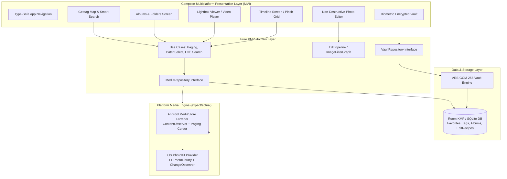

# Modern Kotlin Multiplatform Gallery App — Architecture & Design Specification

**Document ID**: `SPEC-2026-11-03-KMP-GALLERY`  
**Date**: 2026-11-03  
**Status**: APPROVED IN BRAINSTORMING (Pending User Review Gate)  
**Authors**: Senior KMP Engineer, Elite System Architect, UI/UX Expert  
**Target Platforms**: Android (minSdk 24, targetSdk 37) & iOS (iOS 15+) via Compose Multiplatform  

---

## 1. Executive Summary & Vision

The objective of this project is to build an elite, production-grade, highly optimal, and feature-rich **Gallery Application** in **Kotlin Multiplatform (KMP)** using **Compose Multiplatform**. The application benchmarks against the world's leading gallery platforms (Apple Photos, Google Photos, Samsung Gallery, and Aves Gallery), combining:

1. **Unrivaled Fluidity & Rendering Speed**: Constant 60/120fps scrolling across 50,000+ local media items via windowed cursor pagination and a high-performance, multi-tier downsampled bitmap cache.
2. **Next-Generation Multi-Density Interactive Grid**: Smooth pinch-to-zoom scaling between Years, Months, Days, and Masonry perspectives with focal-point tracking and spring physics.
3. **Immersive Gesture-First Media Viewer**: Sub-millisecond double-tap zoom, continuous freeform pan-zoom up to 5x with rubber-banding, and interactive velocity-based swipe-down spring dismiss.
4. **Professional Non-Destructive Photo Editor**: Real-time 60fps GPU preview for color adjustments (exposure, contrast, saturation, warmth, vignette), freeform and preset crop geometry, rotational leveling, and curated filmic filters.
5. **Zero-Knowledge Biometric Encrypted Vault**: Hardware-backed key protection (`KeyStore` / `Secure Enclave`), AES-256-GCM authenticated media payload encryption at rest, and anti-leak screen guards (`FLAG_SECURE` / app-switcher privacy blur).
6. **Deep EXIF Inspector & Privacy Scrubber**: Comprehensive optical and camera metadata display, interactive location geotag mapping, and one-tap metadata stripping for secure sharing.

---

## 2. Technology Stack & Ecosystem

| Component | Technology | Version | Purpose |
|---|---|---|---|
| **Language** | Kotlin Multiplatform | 2.4.21 | Unified cross-platform business logic, domain models, and UI |
| **UI Framework** | Jetpack Compose Multiplatform | 1.12.2 | Reactive, declarative, native-rendered cross-platform UI |
| **Design System** | Material 3 Multiplatform | 1.12.0-alpha03 | Tokenized dynamic theming, custom frosted glass surfaces |
| **Image Loading** | Coil 3 Compose Multiplatform | 3.x | Asynchronous decoding, multi-tier memory/disk cache, platform fetchers |
| **Database** | Room KMP / SQLite | 2.7.x | Local metadata, favorites, album groupings, custom tags, edit recipes |
| **Navigation** | Navigation Compose | 2.8.x | Type-safe declarative cross-platform navigation graph |
| **Dependency Injection** | Koin | 4.x | Lightweight multiplatform service locator and ViewModel injection |
| **Coroutines & Reactive** | kotlinx-coroutines / Flow | 1.10.x | Structured concurrency, backpressure handling, cursor paging |
| **Date & Time** | kotlinx-datetime | 0.6.x | Timeline clustering, timestamp localization |
| **Serialization** | kotlinx-serialization-json | 1.8.x | Serializable edit recipes and metadata exports |
| **Platform Drivers** | Android MediaStore & iOS PhotoKit | Native SDKs | Direct OS-level media querying and reactive change observation |

---

## 3. High-Level System Architecture

The architecture enforces a strict **Layered Clean Architecture with Model-View-Intent (MVI)** to guarantee maximum isolation, testability, and zero vendor lock-in.



---

## 4. Domain Models & Contracts

### 4.1. Core Entities

```kotlin
enum class MediaType {
    IMAGE,
    VIDEO,
    RAW,
    GIF,
    BURST
}

data class MediaItem(
    val id: String,
    val uri: String,
    val displayName: String,
    val mimeType: String,
    val mediaType: MediaType,
    val dateTakenMillis: Long,
    val dateModifiedMillis: Long,
    val width: Int,
    val height: Int,
    val sizeBytes: Long,
    val durationMs: Long? = null,
    val orientation: Int = 0,
    val latitude: Double? = null,
    val longitude: Double? = null,
    val isFavorite: Boolean = false,
    val isTrashed: Boolean = false,
    val isVaulted: Boolean = false,
    val albumIds: Set<String> = emptySet(),
    val tags: Set<String> = emptySet()
)

data class MediaTimelineGroup(
    val title: String,
    val dateRange: ClosedRange<Long>,
    val items: List<MediaItem>
)

data class ExifMetadata(
    val make: String?,
    val model: String?,
    val lensModel: String?,
    val iso: Int?,
    val aperture: Double?,
    val shutterSpeed: String?,
    val focalLength: Double?,
    val flash: String?,
    val whiteBalance: String?,
    val colorSpace: String?,
    val latitude: Double?,
    val longitude: Double?,
    val altitude: Double?,
    val address: String?
)

data class CropRect(
    val left: Float,
    val top: Float,
    val right: Float,
    val bottom: Float
)

data class ColorAdjustments(
    val brightness: Float = 0f,      // [-1.0f .. 1.0f]
    val contrast: Float = 1f,        // [0.0f .. 2.0f]
    val saturation: Float = 1f,      // [0.0f .. 2.0f]
    val warmth: Float = 0f,          // [-1.0f .. 1.0f]
    val highlights: Float = 0f,      // [-1.0f .. 1.0f]
    val shadows: Float = 0f,         // [-1.0f .. 1.0f]
    val vignette: Float = 0f         // [0.0f .. 1.0f]
)

data class EditRecipe(
    val cropRect: CropRect? = null,
    val rotationDegrees: Float = 0f,
    val flipHorizontal: Boolean = false,
    val flipVertical: Boolean = false,
    val adjustments: ColorAdjustments = ColorAdjustments(),
    val filterPresetId: String? = null
)
```

---

## 5. Platform Media Engine (Hardware Storage Abstraction)

### 5.1. Android MediaStore Driver
- **Query Mechanism**: Windowed cursor query on `MediaStore.Files` with projection restricted to essential columns.
- **Continuous Synchronous Sync**: Listens to system storage changes via a specialized `ContentObserver` on `MediaStore.Images.Media.EXTERNAL_CONTENT_URI` and `MediaStore.Video.Media.EXTERNAL_CONTENT_URI`, debounced at 300ms.
- **Scoped Storage Compliance**: 
  - Android 14+ Partial Visual Media Access (`READ_MEDIA_VISUAL_USER_SELECTED`).
  - Native system trash/delete prompts via `MediaStore.createTrashRequest` and `MediaStore.createDeleteRequest`.

### 5.2. iOS PhotoKit Driver
- **Query Mechanism**: `PHAsset.fetchAssetsWithOptions` with descending creation date sort descriptor.
- **Reactive Observation**: Implements `PHPhotoLibraryChangeObserver` to capture background deletions, camera captures, and external edits.
- **Preheating**: Uses `PHCachingImageManager` to preheat adjacent window thumbnails during scroll gestures.

### 5.3. Coil 3 Image & Thumbnail Caching Pipeline
- **Memory Tier**: LRU cache sized to 25% of available JVM heap. Bitmaps are downsampled at decode time to exact render targets (256×256dp for grid tiles; screen-fit for lightbox viewer).
- **Disk Tier**: 250MB disk cache for pre-decoded thumbnails to enable instantaneous offline startup.
- **Hardware Texture Buffers**: Android utilizes `Bitmap.Config.HARDWARE` to keep image textures directly in GPU memory, eliminating CPU-to-GPU transfer jank during rapid scrolling.

---

## 6. UI/UX Design System, Multi-Density Grid & Gestures

### 6.1. Visual Style
- **Aesthetic**: Expressive Dark/Light design with dynamic frosted glass surfaces.
- **Translucent Chrome**: Header bars and floating navigation pills render with `Modifier.blur(20.dp)` and semi-transparent alpha tints, letting imagery subtly shimmer behind controls.
- **Motion Personality**: Spring-based natural physics with damped oscillations (`Spring.StiffnessMediumLow`, `DampingRatioLowBouncy`).

### 6.2. Multi-Density Timeline Grid
- **Four Distinct Densities**:
  1. *Years View* (8 columns): Ultra-dense timeline overview with year separators.
  2. *Months View* (5 columns): Monthly highlight clusters.
  3. *Days View* (3 columns - Default): Daily date headers, day-of-week indicators, and location tags.
  4. *Masonry / Large View* (1–2 columns): Uncropped aspect-ratio showcase.
- **Centroid-Anchored Pinch**: Real-time two-finger pinch gesture dynamically scales the grid canvas while maintaining the photo under the user's touch anchored in space. Releasing springs smoothly to the nearest density tier.

### 6.3. Continuous Marquee Drag-to-Select
- Long-pressing an item enters multi-select mode with a tactile pop.
- Continuing to drag across the grid selects all traversed items uninterrupted.
- Floating bottom bar presents contextual bulk actions: **Share**, **Add to Album**, **Move to Vault**, **Toggle Favorite**, and **Trash**.

### 6.4. Lightbox Fullscreen Viewer
- **Gestures**:
  - Double-tap toggle (1x $\leftrightarrow$ 2.5x centered at tap coordinate).
  - Two-finger pinch-to-zoom (up to 5x with rubber-banding limits).
  - Velocity-aware swipe-down to dismiss: photo shrinks to 70% with fading scrim; releasing past 120dp velocity springs directly into the grid's origin coordinate.
- **Video Player**: Inline seamless loop/play with unobtrusive scrub bar, duration timecode, and audio mute toggle.

---

## 7. Non-Destructive Photo Editor & Vault Security

### 7.1. Photo Editing Engine
- **Non-Destructive Paradigm**: The original image is never modified. All changes are captured as an immutable `EditRecipe`.
- **Compose ColorMatrix Shaders**: GPU-accelerated adjustments for Brightness, Contrast, Saturation, Warmth, Highlights, Shadows, and Vignette rendering at 60fps.
- **Preset Filters**: Instant stylistic filters (*Vivid, Film Noir, Warm Sun, Cool Twilight, Cyberpunk, Chrome, Vintage*).
- **Export Pipeline**: Renders full-resolution target bitmap with combined geometry and color matrix, preserving original EXIF headers.

### 7.2. Zero-Knowledge Biometric Vault
- **Master Key Security**: Hardware-backed key derivation via Android `KeyStore` and iOS `Secure Enclave` guarded by `BiometricPrompt` / FaceID / TouchID or high-entropy PIN.
- **Media Encryption**: AES-256-GCM authenticated cipher with unique 96-bit IVs and 128-bit authentication tags. Files are stored in an isolated, sandboxed directory.
- **Anti-Leak Safeguards**:
  - Automatic `FLAG_SECURE` on Android and privacy veil in iOS multitasking switcher to prevent screenshots or screen recordings.
  - RAM scrubbing of unencrypted byte buffers upon backgrounding or lock timeout.

---

## 8. Verification & Testing Strategy

1. **Unit Testing (Pure Kotlin `commonTest`)**:
   - `MediaRepositoryTest`: Verify cursor pagination, timeline date grouping, and batch mutations using `FakePlatformMediaDataSource`.
   - `VaultCryptoTest`: AES-256-GCM encryption/decryption roundtrip, corrupt ciphertext rejection, and PIN salt verification.
   - `EditRecipeTest`: Serialization/deserialization and color matrix math validation.
   - `ExifParserTest`: Parsing standard and edge-case EXIF headers.
2. **UI & Interaction Verification (`androidHostTest`)**:
   - Compose multi-density grid zoom transitions.
   - Lightbox swipe-to-dismiss gesture physics and spring snap-back thresholds.
   - Selection state management during continuous drag operations.
3. **Platform Performance Verification**:
   - Frame rate monitoring during rapid fling scroll (must maintain $\ge$ 60fps without GC pause stutter).
   - Memory leak analysis during repeated high-res image transitions.

---

## 9. Next Steps
Upon user approval of this specification, we will immediately invoke the **`writing-plans`** skill to draft the detailed, bite-sized, test-driven implementation plan.
